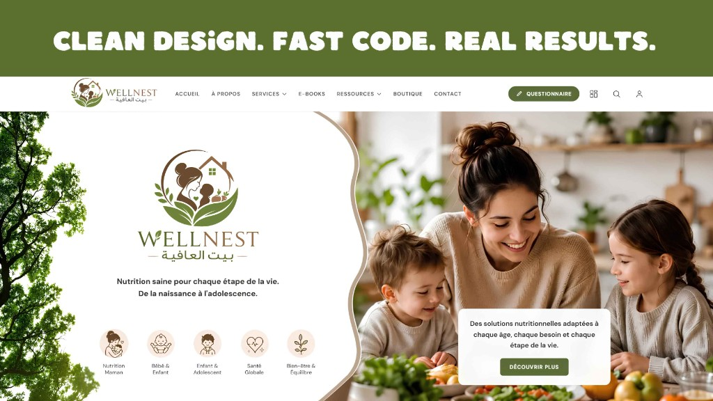

<p align="center">
  
</p>

<h1 align="center">WELLNEST</h1>
<p align="center"><em>بيت العافية · La maison du bien-être</em></p>

<p align="center">
  <strong>Clean design. Fast code. Real results.</strong><br />
  Nutrition saine pour chaque étape de la vie — de la naissance à l’adolescence.
</p>

<p align="center">
  <a href="https://wellnest-i92h.vercel.app/">Live site</a> ·
  <a href="#stack">Stack</a> ·
  <a href="#getting-started">Getting started</a>
</p>

---

## Why Wellnest?

Wellnest is a full-stack wellness platform built for families: maternal nutrition, babies & children, teens, and everyday balance.  
It combines a calm, editorial front experience with a real CMS backend, personalized questionnaires, meal-plan logic, e-books, and email automations.

> Des solutions nutritionnelles adaptées à chaque âge, chaque besoin et chaque étape de la vie.

---

## What you can do

| Experience | What it delivers |
|---|---|
| **Questionnaire** | Guided intake → nutrition bilan & programme recommendations |
| **Programmes** | Life-stage plans with order / WhatsApp flow |
| **Articles & E-books** | CMS-driven content, multilingual-ready, downloadable guides |
| **Dashboard** | Admin space to manage articles, e-books & categories |
| **Auth & profil** | JWT accounts, newsletter preferences, personal area |
| **Nutrition engine** | Algerian market–aware meal targets from Excel → JSON |

---

## Stack

```
┌─────────────────────┐         ┌──────────────────────────┐
│  Next.js 16 · React 19 │  ───►  │  Express 5 · MongoDB      │
│  TypeScript · Tailwind │ proxy │  JWT · Cloudinary · Multer │
│  Nodemailer APIs       │         │  Vercel / Netlify ready   │
└─────────────────────┘         └──────────────────────────┘
```

| Layer | Tech |
|---|---|
| Frontend | Next.js 16 (App Router), React 19, TypeScript, Tailwind CSS 4 |
| Backend | Express 5, Mongoose, JWT + bcrypt, Cloudinary uploads |
| Data | MongoDB · local nutrition JSON (from Excel export scripts) |
| Mail | Nodemailer + HTML templates |
| Hosting | Vercel (frontend + API) |

Frontend talks to the API through a same-origin `/backend` proxy — no CORS pain in the browser.

---

## Getting started

### Frontend

```bash
cd wellnest
npm install
npm run dev
```

Open [http://localhost:3000](http://localhost:3000).

Create a `.env.local` with:

```env
NEXT_PUBLIC_API_URL=http://127.0.0.1:5002
# SMTP_* for transactional emails (newsletter, questionnaire, e-books…)
```

### Backend (sibling repo)

```bash
cd "../wellnest backend"
npm install
cp .env.example .env
npm run dev
```

API default: `http://127.0.0.1:5002`

### Nutrition data (optional re-export)

```bash
npm run nutrition:export
```

Reads the Excel sources at the project root and refreshes `data/nutrition/*.json`.

---

## Project map

```
wellnest/
├── app/                 # Routes (accueil, bilan, ebooks, dashboard…)
├── components/          # UI — hero, forms, listings, dashboard
├── lib/                 # API client, nutrition engine, mail helpers
├── data/nutrition/      # Exported meal / food JSON
├── email templates/     # Transactional HTML
├── scripts/             # Excel → JSON exporters
└── docs/wellnest-hero.jpg
```

---

## Life stages we care about

- Nutrition Maman  
- Bébé & Enfant  
- Enfant & Adolescent  
- Santé Globale  
- Bien-être & Équilibre  

---

<p align="center">
  <sub>Built with care for families · WELLNEST</sub>
</p>
